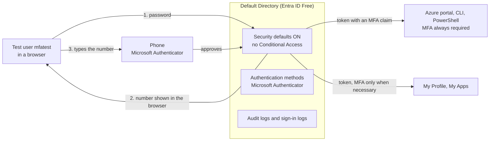

# Entra ID MFA Lab: Multifactor Authentication on the Free Tier

A free Microsoft Entra ID tenant, one test user and one phone. The tenant was already protected by security defaults, so this lab is about testing what that free switch really does, proving it from the logs, breaking it on purpose with a lost-phone scenario, and writing down honestly what the free tier cannot do and what a paid tier would add.

This is Lab 5 of my Azure series: **NTFS File Server, RBAC, Azure Update Manager, Identity Lifecycle, then this one.** The earlier labs controlled access to data, to servers and to the on-premises directory. This one covers the step before all of them: proving that the person signing in is who they say they are.

Nothing is deployed in Azure and nothing here costs money. It is portal-first on purpose, with Terraform for the tenant settings planned as a later phase.

## Why this lab

A password is a secret that can be guessed, reused, phished or leaked. If it is the only proof, then whoever has it is the user. Multifactor authentication (MFA) adds a second proof that an attacker with only the password does not have.

Microsoft gives a free baseline called **security defaults**. It is worth knowing exactly what it does, because that tells you when it is enough and when it is not.

- **Registration is required.** Every user has to register a second factor. In my test there was no option to skip it.
- **Azure management is always challenged.** The Azure portal, the Entra admin center, Azure PowerShell and Azure CLI always need MFA.
- **Standard users are challenged "whenever necessary."** Microsoft decides from location, device, role and task. You cannot make it every time.
- **It cannot be tuned.** No exclusions, no conditions, and it cannot be on at the same time as Conditional Access.

## Architecture



The token that comes back after MFA carries a claim saying MFA was done. Later requests in the same session reuse it, which is why the log shows rows that say the requirement was already satisfied.

## What's inside

This lab has no code to deploy. The repository holds the write-up.

```
azure-entra-mfa-lab/
├── README.md        ← this file
└── .gitignore       ← keeps raw screenshots, exports and CSV files out of Git
```

## Before you start

- A tenant you own on the Free licence, with an administrator account. I used the Default Directory that comes with an Azure subscription.
- The Entra admin center at entra.microsoft.com. Azure CLI is not used in this lab.
- A phone with the Microsoft Authenticator app.
- A private browser window for every test sign-in, so no earlier session is reused.
- A habit of cropping screenshots: leave out the IP address column, tenant and user identifiers, the phone model and any QR code.

Menu names are as I saw them on 2026-10-21, and Microsoft moves things around. In each step below, **what you should see** is what I observed in my own tenant, unless it says "documented," which means it comes from Microsoft's documentation and I did not reproduce it.

## Step 1: Confirm the baseline

**What this step does.** It records the starting state. A test only means something if you know what was there before you changed anything.

**What to do.** Sign in to the Entra admin center as the administrator. Read the tenant Overview. Then open Identity, Overview, Properties, and select Manage security defaults. On the same Properties page, read the setting called Access management for Azure resources.

**What you should see.** The Overview shows Microsoft Entra ID Free, one user and no groups. The Properties page says the organization is protected by security defaults. Access management for Azure resources is set to No.

## Step 2: Predict before you test

**What this step does.** It turns the log reading that follows into a real test. Write your answers down now and compare them in later steps.

**What to do.** Answer these four questions on paper before you continue.

| Question | What Microsoft documents |
|---|---|
| Can a new user skip MFA registration? | No. Registration is required, with no grace period. This changed on July 29, 2024, so older guides that mention a 14-day "Skip for now" window are out of date. |
| Is a standard user asked for MFA on every sign-in? | No. Standard users are prompted "whenever necessary," which Microsoft decides. |
| Is an administrator asked? | Yes. Administrator roles are always challenged. |
| Which sign-ins always need MFA? | Azure management: the Azure portal, the Entra admin center, Azure PowerShell and Azure CLI. |

**What you should see.** Nothing on screen. This step is the written prediction. I got two of these wrong before testing: the registration grace period (Step 4) and the fresh private window (Step 6).

## Step 3: Create the test user

**What this step does.** It gives you a throwaway account, so nothing real is at risk and a mistake cannot lock out the administrator.

**What to do.** In the Entra admin center open Identity, Users, All users, then New user, then Create new user. Give it a user principal name such as `mfatest@<your tenant>.onmicrosoft.com` and a display name. Leave it as a Member and do not assign a role or a group. Let the portal generate the temporary password. Copy it once into the sign-in box in Step 4 and never paste it anywhere else.

**What you should see.** The user list shows two members: your administrator account and `mfatest`. `mfatest` has no roles. If your administrator is a personal Microsoft account, its sign-in name contains `#EXT#`, which is normal for a personal account that owns a tenant.

## Step 4: First sign-in and forced registration

**What this step does.** It shows what a brand new user is made to do, and it registers the second factor. Whoever registers a phone is the person who will be trusted later, so registration is itself a security event.

**What to do.** Open a new private browser window and go to the My Profile page (myaccount.microsoft.com). Sign in as `mfatest` with the temporary password and change the password when asked. Then follow the registration screens: install Microsoft Authenticator on a phone, add a work or school account, scan the QR code shown in the browser, and approve the test sign-in at the end.

**What you should see.** The first sign-in is interrupted with error 50055 because the temporary password has expired and must be changed. After that you are sent straight to a registration flow, and there is no option to skip it. The flow ends with a "Let's try it out" screen that shows a number in the browser, and the number is accepted. Do not publish a screenshot of the QR code, because it carries a registration secret.

## Step 5: Read the audit log

**What this step does.** The audit log answers who changed what, and when. It is the record of the administrative side of the lab.

**What to do.** In the Entra admin center open Monitoring and health, then Audit logs. Filter for the test user and the time window of the lab. Read each activity, its initiator and its status.

**What you should see.** A series of entries covering the account being created and the changes made to it. Each shows when it happened, who or what initiated it, and whether it succeeded. Note which entries the administrator initiated and which the test user did. Do not save the audit log as a CSV into this repository, because it contains user names and identifiers.

## Step 6: Sign in to ordinary apps and read the sign-in log

**What this step does.** It tests the claim that standard users are prompted only "whenever necessary," and it introduces the sign-in log, which records who signed in and how.

**Before you click.** Will signing in to My Profile and My Apps ask for MFA each time? Will a fresh private window force one?

**What to do.** Sign in as `mfatest` to My Profile, then to My Apps, then again from a fresh private window. Then, as the administrator, open Monitoring and health, then Sign-in logs, and filter for `mfatest`. For each row note the application, the status, the error code, the Conditional Access result and the authentication requirement. Crop out the IP address column before you save anything.

**What you should see.** The My Profile and My Apps rows show Success with the requirement **Single-factor authentication** and Conditional Access **Not Applied**. A fresh private window to My Profile did not trigger MFA, which I had not expected. Private windows share cookies while any private window stays open, so that window may not have been fresh, and I did not repeat the test with a password-only sign-in. Treat it as an observation, not proof. One row shows Interrupted with error code 50140. That is the "Stay signed in?" prompt, an expected part of the flow, and it has no authentication details because it is a question to the user and not an authentication step.

**What it proves.** Security defaults do not challenge a standard user on every sign-in, and the tenant has no way to say "always require MFA for this app" without Conditional Access.

## Step 7: Sign in to the Azure portal

**What this step does.** It proves that Azure management is always challenged, and it shows number matching.

**Before you click.** My Profile did not ask for MFA. Will the Azure portal?

**What to do.** In a new private window go to portal.azure.com and sign in as `mfatest`. Watch the browser, then approve in the Authenticator app. Afterwards read the new rows in the sign-in log.

**What you should see.** The browser shows a number and the Authenticator app asks you to type that number in. This is **number matching**: a tap on a notification you did not start is no longer enough, which is the defence against MFA fatigue. The log row for the Azure Portal shows Success with the requirement **Multifactor authentication** and Conditional Access **Not Applied**.

**Reading the log rows correctly.** One human sign-in writes several rows, and the row with the live challenge is separate from the ones that follow. In my log the later rows said **Previously satisfied: true** for the first factor and for MFA on the Authentication Details tab, and the Basic info tab said "MFA requirement satisfied by claim in the token." That means they reused proof from earlier in the session and did not show a fresh challenge. One earlier row showed only the password step (Password in the cloud, Correct password). I looked through several rows for the one naming the method and did not isolate it, so I state the method from what I saw on screen and from Step 8, not from the log.

**Why Conditional Access says Not Applied even though MFA was required.** That column lists Conditional Access policies only, and the tenant has none. The MFA came from security defaults, which is a tenant-wide setting and does not appear as a policy.

## Step 8: Read the Authentication methods page

**What this step does.** It shows where the second factor is recorded and which admin actions exist. This is where a help desk works on a lost phone.

**What to do.** As the administrator open Identity, Users, All users, select `mfatest`, and open Authentication methods. Read the usable methods, the default sign-in method and the buttons along the top. Do not click a button yet.

**What you should see.** Usable methods lists Microsoft Authenticator, with the phone model in the detail column (crop it out). The default sign-in method reads Microsoft Authenticator notification, and the system preferred method reads PhoneAppNotification. The buttons are Add authentication method, Reset password, Require re-register multifactor authentication and Revoke sessions.

## Step 9: Test Revoke sessions

**What this step does.** It shows what Revoke sessions does and, more importantly, what it does not do.

**Before you click.** If you revoke the user's sessions, will the user be locked out? Will the registered phone still work?

**What to do.** On `mfatest`'s Authentication methods page click Revoke sessions and confirm. Then open a new private window and sign in as `mfatest` at portal.azure.com.

**What you should see.** The user can still sign in, and is asked for a number on the phone as before. Microsoft documents that Revoke sessions invalidates refresh tokens and forces re-authentication across active sessions, and that it does not remove registered authentication methods. An access token that is already issued can keep working until it expires. In my test, an Azure portal tab that was already signed in as that user stopped working in under two minutes after I revoked: it showed an "Interaction required" dialog with `login_required` (AADSTS50058). Signing in again asked for the password and then the number. The portal refreshes its tokens often, so it dropped quickly, and other apps may hold on longer.

**What it proves.** On its own, Revoke sessions does nothing against a stolen phone. The phone is still registered and the password is still valid. It is an extra action that cuts off sign-ins already in progress.

## Step 10: Test Require re-register multifactor authentication

**What this step does.** This is the real lost-phone fix. It deletes the old registration and forces a new setup.

**Before you click.** After the click, will the Authenticator still be listed? What will the user see at the next sign-in? (I predicted it would stay until replaced. I was wrong.)

**What to do.** On `mfatest`'s Authentication methods page click Require re-register multifactor authentication and confirm. Refresh the page and read the usable methods. Then open a new private window, sign in as `mfatest` at portal.azure.com and follow the screens. Complete the setup with the same phone.

**What you should see.** The usable methods list changes to **No usable methods**. Microsoft documents that this action deletes the user's registered phone numbers, Microsoft Authenticator apps and software tokens, and deactivates hardware OATH tokens. At the next sign-in the user goes through the full setup: install the app, set up the account, scan a QR code, then a test screen with a number in the browser. After the number is accepted, the usable methods list shows Microsoft Authenticator again.

**What it proves.** The registration is deleted immediately and the only undo is registering again, so an identity check has to come first (Step 11). The browser also showed the number during the registration test, so number matching applies there too.

## Step 11: Verify who is asking before any reset

**What this step does.** A lost-phone call is also the standard story an attacker uses to get a reset. This step is a process, not a click, so it is design only.

**What to do.** Write down the checks your help desk would use:

- Call back on a number already on file in the HR (human resources) system, never one the caller gives you.
- For a manager or administrator account, have the user's manager confirm through a channel the help desk already knows.
- Log a ticket for every reset, with who asked, who verified and who approved.
- Never trust the channel the request came in on, because the caller controls it.
- After the reset, revoke sessions, and reset the password if the phone may be in someone else's hands.

**What you should see.** A written procedure. The audit log from Step 5 is what would show who made the change afterwards. This maps to NIST SP 800-53 IA-5 (authenticator management): verify who you are issuing an authenticator to.

## Step 12: Register and sign in with a passkey

**What this step does.** It tests the strongest sign-in method the Free tier lets you use. A passkey is a key pair: the private key stays on the device, unlocks with a face, fingerprint or PIN, and works only for the real site's domain, which makes it phishing-resistant. Microsoft documents passkeys (FIDO2) as available in all Entra ID editions, including Free.

**Before you click.** Which step does a passkey replace: the password, the number step, or both?

**What to do.**

1. As the administrator open Protection (or Security), then Authentication methods, then Policies, and read the Passkey (FIDO2) row. Do not change anything.
2. Create a new test user and register Microsoft Authenticator as in Steps 3 and 4. I used `mfatest2`.
3. In the Azure portal, signed in as the test user, click the account icon in the top right corner, choose View account, then Security info, then Update info, and choose Add sign-in method.
4. Choose a passkey option and follow the prompts. Microsoft requires a recent MFA before you can register one, so it may ask you to approve a number first.
5. Close every private window, open a new private window, go to My Profile, enter the account name and sign in. Then try the same in a second browser.

**What you should see.** The policies list showed Passkey (FIDO2) already enabled and targeted at All users, so no tenant change was needed. Microsoft Authenticator, Temporary Access Pass, Software OATH tokens and Email OTP were also on, and SMS, voice call, hardware OATH tokens, certificate-based authentication, Verified ID and QR code were off. Add a sign-in method offered three options: Passkey in Microsoft Authenticator, Passkey, and Microsoft Authenticator. The prompts were a confirmation question, then creating the passkey, then naming it. My passkey ended up stored in Windows Hello on my PC, and the Security info list showed **Passkey (Device bound)** with Windows Hello, next to the Authenticator. Creating it signed me out of the session. On a later look the Authenticator entry was gone from the Security info list. I did not remove it and I did not find out why, so check the list again after you add a passkey.

In one sign-in I typed the password and the passkey replaced the number step. In a fresh private window with no password, the passkey was the whole sign-in, and the second browser (Edge) did the same. Windows showed "Sign in with a passkey" and "Passkey for login.microsoft.com" and asked for my Windows Hello PIN. I do not know why the first sign-in asked for a password and the later ones did not. My guess is that Entra offers a registered passkey first once the account name is entered, and the first sign-in was already partway down the password path.

**What the log showed.** I opened three of the newest sign-in rows. All said "Previously satisfied" for the first factor and for MFA, satisfied by claims in the token. I did not find the row that names the passkey, so the passkey use is recorded from what I saw on screen and from the Security info list.

**What it proves.** A passkey replaced the number step and then the whole sign-in. It is tied to the real domain, so a look-alike site would not be offered it, and the key lives on the device, so any browser on that PC can use it.

**What I could not test on the Free tier.** Authentication strengths, which would require a passkey or another phishing-resistant method for chosen users or apps. The Authentication strengths menu item is visible, but a strength is applied through a Conditional Access policy, and that needs Entra ID P1.

## Step 13: Teardown

**What this step does.** It leaves the tenant as you found it.

**What to do.** In the Entra admin center open Identity, Users, All users, select `mfatest` and delete the user. Leave security defaults on. Remove the `mfatest` entry from the Authenticator app on your phone. If you registered a passkey in Step 12, remove it from Windows Hello in Windows Settings as well, because deleting the user in Entra does not remove a device-bound passkey from your computer.

**What you should see.** The user list shows only the administrator. Nothing was deployed in Azure, so nothing is billing. Deleted users stay in the Deleted users list for a limited time, so look there if a repeat run says the name is already taken.

## What this lab did not do

I want to be exact about where this stops. Each of these is something a real environment would do, and none was built.

| Not done | What it is | Why |
|---|---|---|
| Conditional Access policies | Rules for who is challenged, for which app and when | Needs Entra ID P1 or higher |
| Report-only mode and What If | Test a policy against real sign-ins before enforcing it | Part of Conditional Access |
| Break-glass accounts | Two emergency Global Administrators, cloud-only and monitored | Described in the real-environment section below, not created. Exempting them from MFA needs Conditional Access |
| Authentication strengths | Require a chosen method, such as a passkey, for chosen users or apps | A Conditional Access control, which needs Entra ID P1. The menu item is visible on Free, but a strength is only applied through a policy |
| Risk-based policies | Challenge or block based on sign-in and user risk | Needs Entra ID P2 |
| Privileged Identity Management and access reviews | Just-in-time admin access and regular access checks | Listed under P2 on the pricing page |
| Terraform for the tenant | Codify the settings with the azuread provider | Portal first on purpose. A later phase |

## If this were a real environment

**Lockout and break-glass accounts.** I could not do this on the Free tier, so it is not a step in this lab. It is what a real environment would do. Under security defaults the administrator needs MFA too. If the only administrator loses the phone, nobody can reset it, and recovery goes through Microsoft support. The design that prevents it is two emergency (break-glass) accounts:

- Permanent Global Administrators, used only in an emergency.
- Cloud-only, on the `onmicrosoft.com` domain, not synced from on-premises Active Directory and not federated, so they still work if those services are down.
- Long random passwords kept offline, in a vault or a physical safe.
- Their own strong second factor. Microsoft's guidance is phishing-resistant MFA, such as a passkey on a device that is not the daily phone.
- An alert on any sign-in, and a scheduled test.

Why the Free tier cannot do it: security defaults have no exclusions, so these accounts cannot be exempted from MFA the way a Conditional Access policy would allow, and without Conditional Access there are no policies to exempt them from. You can create accounts like these on the Free tier, but the exclusions that make them safe belong to the paid design.

**Policies to build on P1 or higher.** Require MFA for all users, excluding the break-glass accounts. Require stronger, phishing-resistant MFA for administrators. Require MFA for Azure management so that what security defaults did becomes a visible policy. Block legacy authentication. Protect the registration of security information. Add risk-based policies on P2.

**Rollout.** Build and test the break-glass accounts first. Turn each policy on in report-only mode and use What If and the sign-in log to see who would have been blocked. Pilot with a small group, communicate, then enforce. Turn security defaults off only when the policies are ready, because the two cannot run together.

## Cost

Everything I did cost $0. I also priced the paid tiers from Microsoft's own pages on 2026-10-21 and decided to stay on the Free tier.

| Option | Price per user per month | What it adds |
|---|---|---|
| Entra ID Free | $0 | Security defaults only |
| Entra ID P1 | $7.00, paid yearly | Conditional Access (including authentication strengths) and other P1 features such as advanced reports |
| Entra ID P2 | $10.00, paid yearly | P1 plus Identity Protection, risk-based Conditional Access, Privileged Identity Management |
| Microsoft 365 Business Premium | $22.00 paid yearly, or $26.40 monthly | Includes P1 for up to 300 users, plus Microsoft 365 apps and devices |

For two or three licensed users P1 is about $14 to $21 per month. Billing is per user and per subscription term, not per hour, so a few hours of testing does not cost a few hours of price. I did not confirm the terms of the free trial (the number of licences, whether a card is required, whether it converts to paid), so check them before you start one. Prices change.

## NIST SP 800-53 mapping

This is a learning exercise, not a compliance claim.

| Control | Meaning | Where it shows |
|---|---|---|
| IA-2, IA-2(1), IA-2(2) | Identification and authentication, with MFA for privileged and non-privileged users | Steps 4, 7 and 12 |
| IA-5 | Authenticator management | Steps 4, 10 and 11 |
| AC-2 | Account management | Steps 3 and 13 |
| AU-2, AU-12 | Audit events and records | Steps 5 to 7 |
| AC-2(2) | Emergency account management | Real-environment section (design only) |

## Known loose ends

- This is portal-first. The tenant settings are not in Terraform yet.
- I tested a passkey stored in Windows Hello on a PC. I did not test a passkey inside the Microsoft Authenticator app or a physical security key.
- Screenshots are kept out of this repository unless they are cropped, because the raw log rows contain an IP address, tenant and user identifiers and a phone model.

## Wrap-up

This lab took a free Microsoft Entra ID tenant with security defaults on and tested it the way an auditor would: predict, sign in, read the logs, then break it on purpose.

**What it proved.**

- A new user is forced to register a second factor, with no option to skip it.
- Azure management is always challenged with a number-matching prompt, while ordinary apps such as My Profile and My Apps are not.
- The sign-in log records the difference: Single-factor for the ordinary apps and Multifactor for the Azure portal, with Conditional Access Not Applied because the MFA comes from security defaults and not from a policy.
- A passkey, which the Free tier allows, replaced the number step and then the whole sign-in, and it is tied to the real site's domain, so a look-alike site would not be offered it.
- Revoke sessions ends active sign-ins, including an open Azure portal tab within about two minutes, but leaves the phone registered, and Require re-register deletes the registration and forces a new setup, so a lost-phone call needs an identity check before either one.

**Where it stops.** The Free tier gives a solid baseline and nothing more: no per-app rules, no exclusions, no report-only testing, no authentication strengths. Those are Conditional Access features, and I have laid out the design for them above without claiming I built it.

Everything in this repository is something I did or something I clearly marked as design. Try the lab for yourself. It is a good start at learning MFA.
