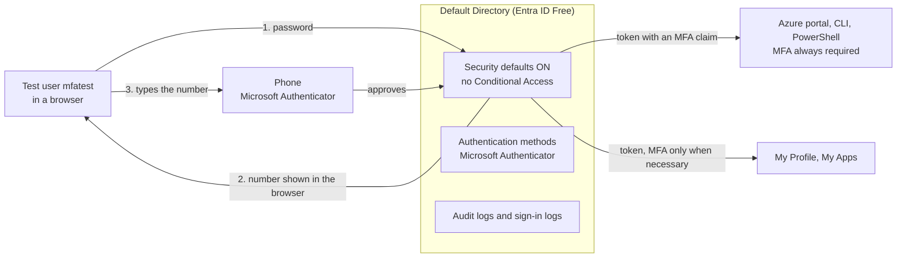

# Entra ID MFA Lab: Multifactor Authentication on the Free Tier

A free Microsoft Entra ID tenant, one test user and one phone. I turned on nothing extra: the tenant was already protected by security defaults, so the lab is about testing what that free switch really does, proving it from the logs, breaking it on purpose with a lost-phone scenario, and writing down honestly what the free tier cannot do and what a paid tier would add.

This is Lab 5 of my Azure series: **NTFS File Server, RBAC, Azure Update Manager, Identity Lifecycle, then this one.** The earlier labs controlled access to data, to servers and to the on-premises directory. This one covers the step before all of them: proving that the person signing in is who they say they are.

Nothing is deployed in Azure and nothing here costs money. It is portal-first on purpose, with Terraform for the tenant settings planned as a later phase.

## Why this lab

A password is a secret that can be guessed, reused, phished or leaked. If it is the only proof, then whoever has it is the user. MFA adds a second proof that an attacker with only the password does not have.

Microsoft gives a free baseline called security defaults. It is worth knowing exactly what it does, because that tells you when it is enough and when it is not.

- **Registration is required.** Every user has to register a second factor. In my test there was no option to skip it.
- **Azure management is always challenged.** The Azure portal, the Entra admin center, Azure PowerShell and Azure CLI always need MFA.
- **Standard users are challenged "whenever necessary."** Microsoft decides from location, device, role and task. You cannot make it every time.
- **It cannot be tuned.** No exclusions, no conditions, and it cannot be on at the same time as Conditional Access.

## Architecture



The token that comes back after MFA carries a claim saying MFA was done. Later requests in the same session reuse it, which is why the log shows rows that say the requirement was already satisfied.

## What's inside

This lab has no code to deploy. The repository holds the write-up.

```
azure-entra-mfa-lab/
├── README.md        ← this file
└── .gitignore       ← keeps raw screenshots, exports and CSV files out of Git
```

## Try it yourself

You need a tenant you own with the Free licence, an administrator account, a phone with the Microsoft Authenticator app, and a private browser window for each test sign-in. Menu names are as I saw them on 2026-10-21 and Microsoft moves things around.

| Step | What to do | What you should see |
|---|---|---|
| 1 | In the Entra admin center check the Overview and then Properties, Manage security defaults | Entra ID Free, and security defaults enabled |
| 2 | Write down your predictions: can MFA registration be skipped, are standard users asked on every sign-in, which sign-ins are always challenged | You compare them to the results below |
| 3 | Create a Member user with no roles. Let the portal make the temporary password and never paste it anywhere | A user that cannot change anything in the tenant |
| 4 | Sign in as that user at the My Profile page in a private window, change the password, and register Microsoft Authenticator | A forced registration with no skip option |
| 5 | Read the audit log filtered to the user | Who created and changed the account, and when |
| 6 | Sign in to My Profile and My Apps, including from a fresh private window, then read the sign-in log | Single-factor, Conditional Access Not Applied |
| 7 | Sign in at portal.azure.com as the test user | A number in the browser, typed into the phone |
| 8 | Open the user's Authentication methods page | Microsoft Authenticator listed, and four admin buttons |
| 9 | Click Revoke sessions and sign in again | You can still sign in, because the phone is still registered |
| 10 | Click Require re-register multifactor authentication and sign in again | No usable methods, then a full setup flow |
| 11 | Think through how you would verify a caller before any reset | A written process, not a click |
| 12 | Design the lockout protection and the paid-tier policies | Documents, not changes |
| 13 | Delete the test user. Leave security defaults on | A clean tenant |

## What I tested and found

### Does a standard user get MFA on every sign-in?

No. The My Profile and My Apps sign-ins in the log showed Success with the requirement **Single-factor authentication** and the Conditional Access result **Not Applied**. A fresh private window did not force a prompt either. I had expected it to, and I was wrong.

One row showed Interrupted with error code 50140. That is the "Stay signed in?" prompt, not a failure, and the row has no authentication details because it is a question to the user and not an authentication step.

### Does the Azure portal?

Yes. Signing in to portal.azure.com as the same user showed a number in the browser, and the Authenticator app asked me to type it in. That is **number matching**. The log row for the Azure Portal showed Success with the requirement **Multifactor authentication**. A tap on a notification you did not start is no longer enough, which is the defence against MFA fatigue.

### Reading the log correctly

One human sign-in writes several log rows. The later rows said **Previously satisfied: true** for both the first factor and MFA, with the note "MFA requirement satisfied by claim in the token." So they were reusing proof from earlier in the session, and did not show a fresh challenge. I looked through several rows for the one with the live method and did not isolate it, so in this write-up the method comes from what I saw on screen and from the Authentication methods page (Microsoft Authenticator notification), and not from the log.

### Why does Conditional Access say Not Applied?

That column lists Conditional Access policies only, and this tenant has none. The MFA came from security defaults, a tenant-wide setting, and it does not appear as a policy.

## The lost phone

A user losing a phone is the most common real MFA problem, and it is also the story an attacker uses to get a reset. I tested two actions on the user's Authentication methods page.

**Revoke sessions** ends sign-ins that are already in progress, but it does not remove the registered phone or change the password. After revoking, the user could sign in again with the same phone and was asked for a number as before. On its own it does nothing against a stolen phone. Microsoft documents that an access token already issued can keep working until it expires.

**Require re-register multifactor authentication** is the real fix. After the click the usable methods list said **No usable methods**. Microsoft documents that it deletes the user's registered phone numbers, Microsoft Authenticator apps and software tokens. I had predicted the old registration would stay until replaced, and that was wrong. At the next sign-in the user went through the full setup: install the app, add the account, scan a QR code, then a test screen with a number in the browser. After the number was accepted the Authenticator was listed again.

The registration is deleted immediately and the only undo is registering again, so an identity check comes first:

- Call back on a number already on file in the HR (human resources) system, never one the caller gives you.
- For a manager or administrator account, get the user's manager to confirm through a channel the help desk already knows.
- Log a ticket for every reset, with who asked, who verified and who approved.
- Never trust the channel the request came in on.
- After the reset, revoke sessions, and reset the password if the phone may be in someone else's hands.

This maps to NIST SP 800-53 IA-5 (authenticator management): verify who you are issuing an authenticator to.

## What this lab did not do

I want to be exact about where this stops. Each of these is something a real environment would do, and none was built.

| Not done | What it is | Why |
|---|---|---|
| Conditional Access policies | Rules for who is challenged, for which app and when | Needs Entra ID P1 or higher |
| Report-only mode and What If | Test a policy against real sign-ins before enforcing it | Part of Conditional Access |
| Break-glass accounts | Two emergency Global Administrators, cloud-only and monitored | Designed, not created. Exempting them from MFA needs Conditional Access |
| Authentication strengths and passkeys | Require phishing-resistant methods | Explained only. I did not test whether the Free tier lets you enable them |
| Risk-based policies | Challenge or block based on sign-in and user risk | Needs Entra ID P2 |
| Privileged Identity Management and access reviews | Just-in-time admin access and regular access checks | Listed under P2 on the pricing page |
| Terraform for the tenant | Codify the settings with the azuread provider | Portal first on purpose. A later phase |

## If this were a real environment

**Lockout.** Under security defaults the administrator needs MFA too. If the only administrator loses the phone and there is no other admin, nobody can reset it, and recovery goes through Microsoft support. The design that prevents it is two **break-glass** accounts: permanent Global Administrators, cloud-only on the `onmicrosoft.com` domain (not synced from on-premises Active Directory and not federated, so they still work if those are down), with long random passwords kept offline, their own phishing-resistant second factor such as a passkey on a device that is not the daily phone, an alert on any sign-in, and a scheduled test. On the Free tier they cannot be exempted from MFA, because security defaults have no exclusions.

**Policies to build on P1 or higher.** Require MFA for all users, excluding the break-glass accounts. Require stronger, phishing-resistant MFA for administrators. Require MFA for Azure management so that what security defaults did becomes a visible policy. Block legacy authentication. Protect the registration of security information. Add risk-based policies on P2.

**Rollout.** Build and test the break-glass accounts first. Turn each policy on in report-only mode and use What If and the sign-in log to see who would have been blocked. Pilot with a small group, communicate, then enforce. Turn security defaults off only when the policies are ready, because the two cannot run together.

## Cost

Everything I did cost $0. I also priced the paid tiers from Microsoft's own pages on 2026-10-21 and decided to stay on the Free tier.

| Option | Price per user per month | What it adds |
|---|---|---|
| Entra ID Free | $0 | Security defaults only |
| Entra ID P1 | $7.00, paid yearly | Conditional Access, passwordless and phishing-resistant authentication |
| Entra ID P2 | $10.00, paid yearly | P1 plus Identity Protection, risk-based Conditional Access, Privileged Identity Management |
| Microsoft 365 Business Premium | $22.00 paid yearly, or $26.40 monthly | Includes P1 for up to 300 users, plus Microsoft 365 apps and devices |

For two or three licensed users P1 is about $14 to $21 per month. Billing is per user and per subscription term, not per hour, so a few hours of testing does not cost a few hours of price. I did not confirm the terms of the free trial (the number of licences, whether a card is required, whether it converts to paid), so check them before you start one. Prices change.

## NIST SP 800-53 mapping

This is a learning exercise, not a compliance claim.

| Control | Meaning | Where it shows |
|---|---|---|
| IA-2, IA-2(1), IA-2(2) | Identification and authentication, with MFA for privileged and non-privileged users | Registration and the always-challenged Azure management sign-in |
| IA-5 | Authenticator management | Registering, deleting and re-registering the second factor, and verifying identity before a reset |
| AC-2 | Account management | Creating and deleting a test user with no roles |
| AU-2, AU-12 | Audit events and records | The audit log and the sign-in log |
| AC-2(2) | Emergency account management | The break-glass design (design only) |

## What went wrong

**I got two things wrong before I tested them.** I expected a 14-day "Skip for now" registration window under security defaults, and I expected a fresh private window to force an MFA prompt. Microsoft's documentation says the grace period was removed on July 29, 2024, and the second one is simply not how "whenever necessary" works. The test settled both. Older guides still describe the grace period, so check the date on anything you read.

**I predicted the old phone registration would stay until a new one replaced it.** It does not: Require re-register deletes it straight away.

**I assumed revoking sessions would lock the user out.** It did not, because the phone and the password were untouched.

**Calling the Graph API from the Azure CLI failed.** An `az rest` call returned an Internal Server Error and then Forbidden, because the Azure CLI token did not have the Graph scopes. I did not work around it and used the portal instead.

**Hunting for the live challenge in the log.** It took several rows to see that most of them were token reuse. The honest answer is that I did not isolate the row that names the method, and I say so above.

## Known loose ends

- This is portal-first. The tenant settings are not in Terraform yet.
- I did not test passkeys or hardware keys.
- I did not confirm how the old browser window behaved after I revoked sessions.
- Screenshots are kept out of this repository unless they are cropped, because the raw log rows contain an IP address, tenant and user identifiers and a phone model.

## What I took from this

The free baseline is better than I expected and also more limited than I expected. It makes sure nobody is left without a second factor and it always protects Azure management, and that matters. But it cannot say "always require MFA for this app" or "block this country" or "treat admins differently," and every one of those is a Conditional Access question.

The log was the best teacher. "The sign-in succeeded" and "MFA happened" are different statements, and the log showed that the second one was mostly a token being reused. The lost-phone tests were the other lesson: three buttons that sound alike, delete a method, require re-register and revoke sessions, do three different things, and picking the wrong one leaves a stolen phone working.

Next I would turn security defaults off in a throwaway tenant with a P1 trial, build the break-glass accounts and one report-only policy, and codify the settings with Terraform.
